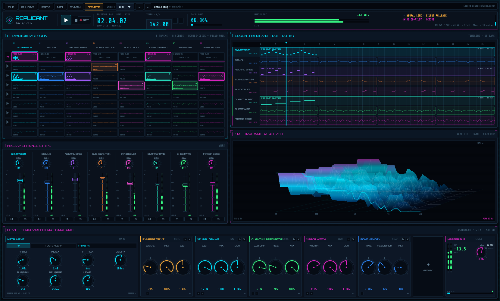
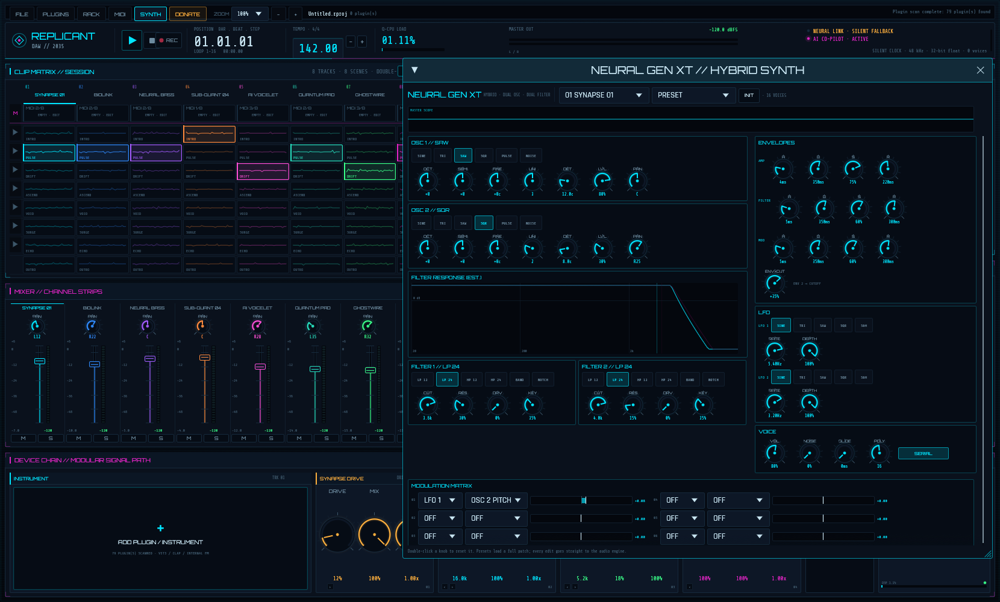
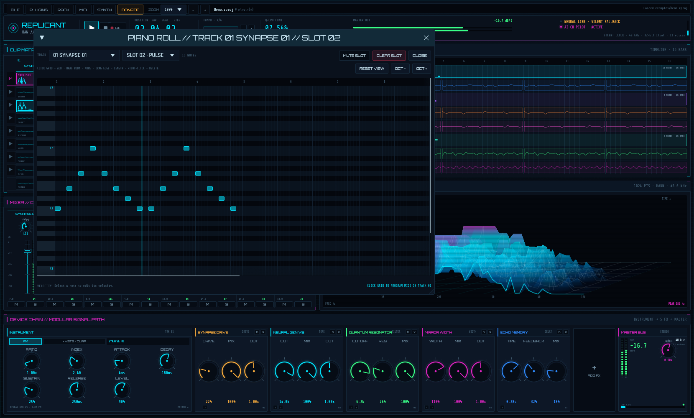
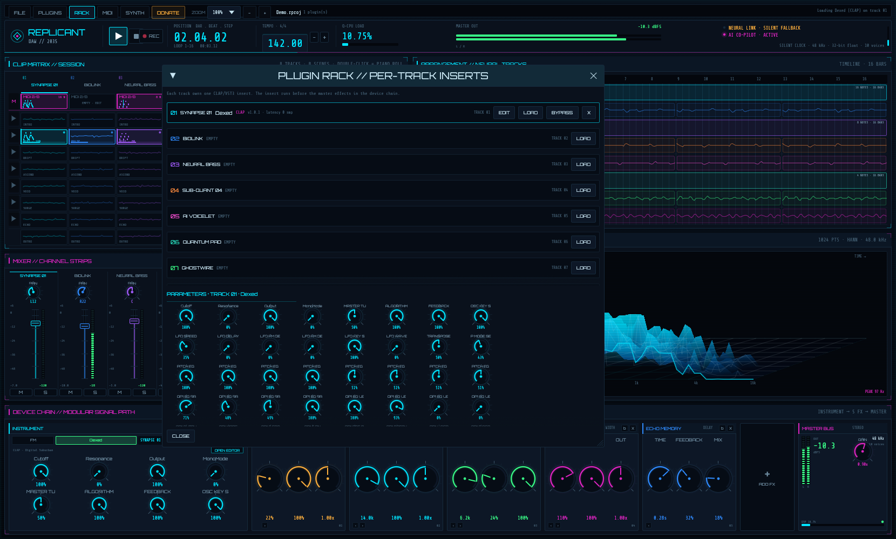
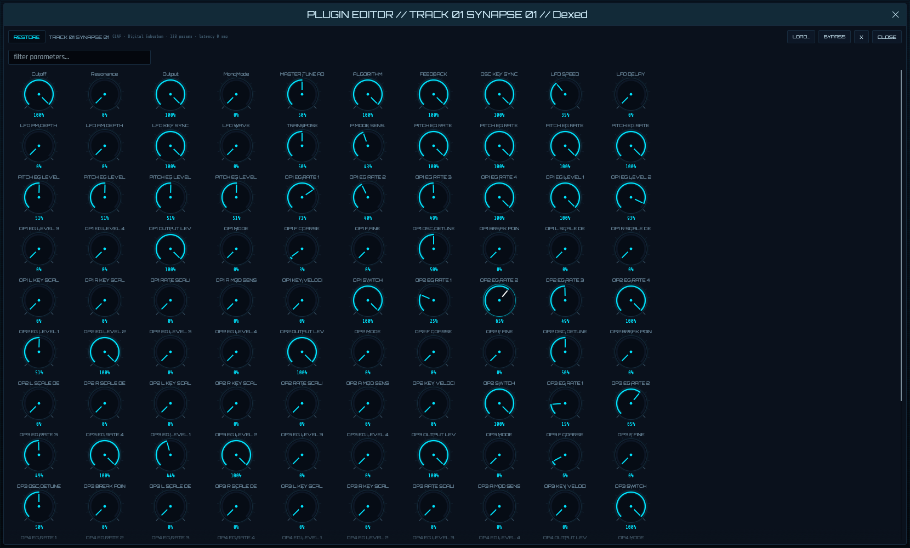

# Replicant DAW

A cyberpunk DAW prototype in Rust: a real-time FM synthesizer and stereo mix bus
driven by `cpal`, a neon session interface built with `eframe`/`egui` on `wgpu`,
lock-free `rtrb` queues between the threads, MIDI recording, project files, a
modular effect chain and in-process CLAP/VST3 plugin hosting.

**Version 1.0.4** · MIT · Linux, macOS and Windows.



> Captured headlessly from the real release binary with the silent fallback
> clock (no audio device attached), so the badges show `SILENT FALLBACK`.
> The session shows recorded MIDI clips in the matrix and arrangement, and a
> five-module effect chain.









## What's new in 1.0.4

- **Independent session clips** — every one of the 8 × 8 slots now owns its own
  MIDI clip. Programming a slot no longer copies the pattern to the slots below
  it; each slot can be empty, hold generative material, or hold its own MIDI
  clip, and the piano roll switches slots with a selector.
- **Editable track names** — double-click a track name in the session header,
  mixer strip or arrangement gutter to rename it. Names appear everywhere and
  are saved in the project.
- **Instrument slot** — the device chain starts with a single `INSTRUMENT`
  module: `FM` plays the internal `NEURAL GEN V5` synth, `PLUGIN` plays the
  hosted CLAP/VST3 instrument, and loading an instrument plugin takes over the
  track automatically. Sequencer and recorded MIDI now reach the plugin insert
  too, including note-offs.
- **Full-screen plugin editor** — open any track insert in a large parameter
  editor and press `FULLSCREEN` (or `Esc` to restore). Plugin parameters can be
  filtered by name.
- **Project format v4** — stores per-slot MIDI clips, track names and the
  instrument-slot choice. v3 files migrate their single clip into the slot they
  played from; v1/v2 files still load.

## Features

- **Two-thread audio architecture**
  - Audio thread: the `cpal` output callback renders stereo at 48 kHz, 32-bit
    float when the device supports it.
  - UI thread: `eframe` + `egui` with the `wgpu` renderer.
  - Lock-free SPSC `rtrb` rings for commands, telemetry, scope samples, MIDI,
    recording events and plugin audio blocks.
- **Instrument slots**
  - Each track has one instrument slot: internal 2-op FM synth or a hosted
    CLAP/VST3 instrument.
  - Loading an instrument plugin mutes the internal synth for that track;
    effect plugins stay inserts and keep the synth audible.
  - Full-screen parameter editor per insert, with a name filter.
- **Synthesis**
  - 8 tracks with a 32-voice polyphonic two-operator FM engine.
  - Per-track editable FM ratio, modulation index and ADSR envelope.
  - Per-track gain, pan, mute and solo; equal-power stereo bus.
  - Generative 16-step clip patterns across 8 scenes in a 16-bar loop.
- **Modular master chain**
  - `SYNAPSE DRIVE`: saturation, wet mix and output trim.
  - `NEURAL GEN V5`: high-cut tone filter.
  - `QUANTUM RESONATOR`: resonant topology-preserving state-variable low-pass.
  - `MIRROR WIDTH`: mid/side stereo width.
  - `ECHO MEMORY`: stereo delay with feedback and wet mix.
  - Add, reorder, bypass and close modules; master gain, soft clip, DC blocking
    and a hard output guard stay fixed at the end of the chain.
- **MIDI recording**
  - Live MIDI input through `midir` (ALSA, CoreMIDI, WinMM), with rescan and
    device selection.
  - Arm a track, hit `REC`, and play: notes are captured at 16th-note
    resolution into the track's launched session slot, replacing its generative
    pattern. Other slots keep their own material.
  - An on-screen two-octave keyboard feeds the same MIDI path, so the workflow
    is testable without hardware.
  - Clips are visible in the session matrix and the arrangement, and can be
    muted without deleting them.
- **Piano roll and audio clip editing**
  - Double-click a session or arrangement clip to program MIDI for that slot.
  - 16-bar grid at 16th-note resolution, four-octave view with octave shift.
  - Add, move, resize, delete, mute and set velocity per note.
  - Each session slot is independent; the editor has a slot selector.
  - Audio clips expose clip gain and loop-normalized fade-in/fade-out.
- **Track management**
  - Rename tracks from the session, mixer or arrangement; names are saved.
  - Track names drive the session, arrangement, mixer, rack and editors.
- **Project save / load**
  - Versioned JSON `.rproj` files: tempo, mix, scenes, track names, per-slot
    MIDI clips, synth parameters, effect chain, master gain and plugin state
    (base64).
  - `Ctrl+S` quick save, a project browser, and `--project <path>` on startup.
  - Format v1 files still load; the legacy fixed FX block becomes a chain.
  - `examples/Demo.rproj` ships with MIDI clips and a five-module chain.
- **Plugin hosting**
  - **CLAP**: in-process hosting with audio, note/parameter events and state.
  - **VST3**: in-process hosting with audio, MIDI, parameters and state.
  - **VST2**: discovered and listed, but not hostable because the Steinberg SDK
    is proprietary and not vendored (see [docs/PLUGINS.md](docs/PLUGINS.md)).
  - **Audio Unit**: not implemented (macOS only).
  - One insert slot per track (8 total), bypass, per-slot parameter knobs and
    latency reporting. Inserts run on the track bus before the master chain.
- **Session UI**
  - Menu bar with project, plugin, synth, MIDI and zoom controls.
  - Transport with bar/beat/step counter, editable BPM, play/stop, REC, audio
    callback CPU meter, master meter and link status.
  - Clip matrix (8 × 8) plus a MIDI row, with a per-slot piano-roll preview,
    live step progress and scene launch.
  - Mixer strips with vertical faders, LED dB meters, pan and mute/solo.
  - Arrangement lanes with a 16-bar ruler, animated playhead and MIDI clip
    containers.
  - Live spectral waterfall computed with a 1024-point Hann-windowed FFT and
    rendered as a coloured 3D mesh with `egui::Painter`.
- **Robust host handling**
  - Prefers a 48 kHz stereo F32 device configuration and converts to the
    device's sample format when needed.
  - If no output device exists, a real-time silent clock keeps the engine,
    meters, FFT and plugin chain running and the UI shows `SILENT FALLBACK`.

## Plugin support

| Format | Scan | Host | Notes |
| --- | --- | --- | --- |
| CLAP | yes | yes | audio + note/param events + state |
| VST3 | yes | yes | audio + MIDI + params + state |
| VST2 | yes | no | proprietary SDK not vendored |
| AU / AUv3 | no | no | macOS-only, not implemented |

Plugins run on a dedicated worker thread, exchanging 512-frame stereo blocks
with the engine through lock-free rings. Each block carries one stereo bus per
track, so an insert processes only the track it is assigned to. This keeps
`!Send` plugin handles out of the audio callback and isolates load/state cost
from the UI.

**VST3 unload workaround:** some third-party VST3s (verified with OB-Xd) crash
asynchronously inside their own teardown. Closing such a slot stops its DSP and
parks the instance for the lifetime of the process instead of destroying it, so
the application stays stable. The trade-off is that the parked plugin's memory
is only reclaimed when the app exits; CLAP instances are destroyed normally.

Details, scan paths and troubleshooting: [docs/PLUGINS.md](docs/PLUGINS.md).

## Requirements

- Rust 1.85 or newer (stable toolchain).
- Linux: ALSA development headers and the usual windowing libraries.

  ```bash
  # Debian/Ubuntu
  sudo apt install build-essential pkg-config libasound2-dev \
      libxkbcommon-dev libwayland-dev libx11-dev libxi-dev

  # Fedora
  sudo dnf install alsa-lib-devel libxkbcommon-devel wayland-devel \
      libX11-devel libXi-devel
  ```

- macOS: Xcode command line tools; no extra packages.
- Windows: MSVC build tools; no extra packages. WASAPI is used through `cpal`.

Fonts and the app icon are embedded, so there are no runtime asset paths.

## Run

```bash
cargo run --release
```

```bash
cargo run --release -- --devices        # list audio output devices
cargo run --release -- --audio-check    # open the default device and verify telemetry
cargo run --release -- --selftest       # DSP, chain, project, MIDI and clock smoke test
cargo run --release -- --project examples/Demo.rproj
cargo test                              # 72 unit tests
cargo clippy --all-targets -- -D warnings
```

Environment variables:

```bash
REPLICANT_DAW_NO_AUDIO=1        # force the silent fallback clock
REPLICANT_DAW_SIZE=1200x760     # initial window size (clamped to the minimum)
REPLICANT_DAW_ZOOM=125          # UI scale at startup (75..150)
REPLICANT_DAW_PROJECT=x.rproj   # load a project at startup
REPLICANT_DAW_PROJECTS=dir      # override the projects directory
REPLICANT_DAW_PLUGIN_PATH=a:b   # extra plugin scan roots
REPLICANT_DAW_OPEN_PLUGIN=/path/to/plugin.vst3   # QA: load into slot 1
REPLICANT_DAW_SMOKE=docs/screenshot.png
REPLICANT_DAW_SMOKE_SECS=4      # auto-play, wait, screenshot, exit
REPLICANT_DAW_SMOKE_WINDOWS=rack,midi,synth      # open utility windows
REPLICANT_DAW_SMOKE_SAVE=/tmp/demo.rproj         # save a project before exiting
WGPU_BACKEND=gl|vulkan|metal|dx12
```

Default project directory:

- Linux: `~/.local/share/replicant-daw/projects`
- macOS: `~/Library/Application Support/ReplicantDaw/projects`
- Windows: `%APPDATA%\ReplicantDaw\projects`

## Controls

- **Space** — play / stop. **Esc** — stop and rewind.
- **Ctrl+S** — save. **Ctrl+O** — project window. **Ctrl+P** — plugin browser.
- **Ctrl + / Ctrl − / Ctrl 0** — zoom in / out / reset. The `ZOOM` menu offers
  75%, 90%, 100%, 110%, 125% and 150%.
- **Play / Stop / REC** — transport and MIDI recording on the selected track.
- **BPM** — click to type, drag vertically, or use `-` / `+`.
- **MIDI row** — click a track's clip to mute/unmute it; empty slots prompt to
  arm REC. The row also shows a live loop position.
- **Clip slot** — click to launch, click again (or right-click) to stop. The
  triangle at the left of a row launches the whole scene.
- **Track header** — selects the track (also the MIDI input/record target and
  the track edited by the synth module).
- **Fader** — drag vertically, double-click for 0 dB.
- **Pan knob** — drag vertically, double-click to centre.
- **M / S** — mute and solo.
- **SYNTH module** — click its track strip to cycle tracks; drag its seven
  knobs. `SYNTH` in the menu opens the larger editor with RESET.
- **Effect module** — drag knobs; `b` bypasses, `X` closes, `‹ ›` reorders.
  `+ ADD FX` opens the module menu (and `RESET CHAIN`).
- **Rack** — load, bypass or remove plugins; up to 16 parameters per slot.
- **MIDI** — connect an input, play the on-screen keyboard, arm REC, clear a
  clip, toggle MIDI to plugins.

## Architecture

```
┌────────────────────────── UI thread (eframe / egui / wgpu) ─────────────────────────┐
│ menu+zoom · transport · clip matrix+MIDI row · mixer · lanes · FFT · chain · windows  │
│    │ Command              ▲ Telemetry / scope / record events                        │
└────┼──────────────────────┼─────────────────────────────────────────────────────────┘
     │ rtrb                 │ rtrb
┌────▼──────────────────────┴─────────────────────────────────────────────────────────┐
│ Audio thread: cpal callback (or paced silent clock)                                  │
│ sequencer → FM voices (per-track params) → track mix → modular FX chain → master      │
│      │ dry blocks                                                ▲ processed blocks  │
└──────┼───────────────────────────────────────────────────────────┼───────────────────┘
       │ rtrb                                                      │ rtrb
┌──────▼───────────────────────────────────────────────────────────┴───────────────────┐
│ Plugin worker thread: CLAP + VST3 instances, params, state                           │
└──────────────────────────────────────────────────────────────────────────────────────┘

MIDI hardware ──midir──▶ bridge ring ──UI pump──▶ MIDI ring ──▶ engine (voices + record)
```

- `src/audio/engine.rs` renders audio. It never allocates, locks or calls into
  third-party code; the plugin chain only moves blocks between rings.
- `src/audio/effects.rs` implements the chain modules with fixed state and
  smoothed parameters.
- `src/plugins/worker.rs` owns all plugin handles. It is created inside its own
  thread because plugin instances are not `Send`.
- `src/studio.rs` owns MIDI, plugins, zoom and projects on the UI side.
- `src/project.rs` is the serialized session model.

## DSP details

- Two-operator phase-modulation voice: `sin(phase + index * env * sin(mod_phase))`,
  with per-track ratio, index and ADSR edited live from the UI.
- The sequencer derives the current 16th note from a sample-accurate transport
  position, so tempo changes and loops stay tight.
- Each track runs its instrument slot (internal FM synth or plugin) and then
  sums into the master bus. Chain order is user-defined; master gain, soft
  clip, DC blocker and output guard always come last.
- Effect parameters are clamped to their module ranges and smoothed to avoid
  zipper noise. Delay runs a 1.05 s stereo line.
- `src/dsp/spectrum.rs` uses `rustfft` with a 1024-point Hann window and
  log-spaced display bins from 30 Hz to 16 kHz.

## Project format

`.rproj` is versioned JSON (format 4):

```json
{
  "format_version": 4,
  "app_version": "1.0.4",
  "name": "Neon Demo",
  "bpm": 142.0,
  "effects": [
    { "kind": "DRIVE",  "params": [0.22, 1.0, 1.0], "bypass": false },
    { "kind": "FILTER", "params": [6200.0, 0.24, 1.0], "bypass": false },
    { "kind": "DELAY",  "params": [0.28, 0.32, 0.18], "bypass": false }
  ],
  "master_gain": 0.9,
  "tracks": [
    { "name": "MY LEAD", "gain_db": -7.0, "pan": -0.12,
      "mute": false, "solo": false, "scene": 1,
      "clip_gain_db": 0.0, "fade_in": 0.0, "fade_out": 0.0,
      "instrument_plugin": false,
      "synth": { "ratio": 1.0, "index": 2.4, "attack": 0.004,
                 "decay": 0.18, "sustain": 0.25, "release": 0.25,
                 "level": 0.9 },
      "clips": [
        { "scene": 1, "enabled": true,
          "notes": [ { "note": 60, "velocity": 100,
                       "start_step": 0, "length_steps": 2 } ] }
      ] }
  ],
  "plugins": [
    { "slot": 0, "name": "Dexed", "format": "CLAP",
      "path": "/usr/lib/clap/Dexed.clap",
      "bypass": false, "state": "<base64>" }
  ]
}
```

`tracks[].clips` holds one entry per non-empty session slot, so each of the
8 × 8 slots is independent. `plugins[].slot` is the track index and
`instrument_plugin` records the instrument-slot choice (`null` follows the
plugin type). Unknown fields are ignored (forward compatible), while a newer
`format_version` is rejected with a clear error. Loading a v3 file moves its
single `notes` clip into the slot named by `scene`; v1 files translate their
`fx` block into chain modules.

## Verification

Verified on Linux (Arch, kernel 7.2) with a real AMD/Radeon desktop, a
Keystation 49 MK3 MIDI keyboard, and third-party plugins already installed:

```
$ cargo test
test result: ok. 86 passed; 0 failed

$ cargo clippy --all-targets -- -D warnings
Finished

$ ./target/release/replicant-daw --selftest
- rendered 8.0 s of audio in 0.106 s (75.7x realtime)
- lock-free path: telemetry playing=true peaks=0.442 | scope frames=32768
- chain: 4 default modules -> 4 after remove/add; synth index 3.2
- project: 2 module(s), 1 note(s), synth index 4.25
- midi recording: 1 note(s), 2 UI event(s)
- midi inputs available: 5
- midi input opened: Midi Through:Midi Through Port-0 14:0
- silent clock: peak 0.577, playing=true
SELFTEST OK

$ ./target/release/replicant-daw --audio-check
AUDIO OK: Alsa | Default Audio Device | 48000 Hz | ... telemetry frames | stopped (silent)
```

Additional manual checks:

- **VST3**: `OB-Xd 3.vst3` loads on the worker thread, exposes its parameters,
  reports latency and produces audio from MIDI; closing the slot no longer
  crashes thanks to the parked-instance workaround.
- **CLAP**: `Dexed.clap` loads into a track's instrument slot, exposes 128
  parameters, takes over the track's sound source and is playable from the
  sequencer and the piano roll. The full-screen editor and parameter filter
  were captured from the running binary.
- **Independent slots**: an injected double-click on the session cell for
  track 1 / slot 3 opened `PIANO ROLL // TRACK 01 // SLOT 03`, a note added
  there left slot 2's 16-note clip untouched, and the matrix only kept the
  slot-2 clip. Also covered by engine and UI-state tests.
- **Projects**: saved a session with chain, synth parameters, per-slot clips,
  track names and the instrument choice, then loaded it in a fresh process;
  `examples/Demo.rproj` is the same file in format v4.
- **UI zoom**: captured at 125% (`docs/synth.png`), with the logical layout
  preserved and the synth editor open.
- **Screenshots**: `docs/screenshot.png`, `docs/synth.png`, `docs/plugins.png`,
  `docs/piano-roll.png` and `docs/plugin-editor.png` are captured from the real
  binary under Xvfb.

The CI matrix runs tests and the self-test on Ubuntu, macOS and Windows. The
release workflows cross-build both macOS architectures and publish packages for
Linux, macOS and Windows on every tag (`.github/workflows/release-*.yml`).

## Limitations / next steps

This is a prototype, not a production DAW:

- Plugin hosting is in-process: a crashing plugin takes the app down, and the
  plugin worker adds one block of latency. An out-of-process sandbox is the
  natural next step.
- The VST3 workaround parks closed instances instead of destroying them, so
  their memory is held until exit.
- No native plugin GUI embedding: the plugin editor is a full-screen parameter
  surface, not the vendor's own window.
- VST2 and Audio Unit hosting are not implemented (see the matrix above).
- The modular effects are still a master chain; per-track inserts host one
  plugin each. There is no arbitrary per-track effect chain yet.
- One MIDI clip per session slot and one instrument plugin per track. There is
  no arrangement clip model (the arrangement mirrors the launched slot) and no
  MIDI export, automation lanes or undo. Recording replaces the target clip.
- Instrument-slot choice and effect-plugin inserts share the same slot: an
  instrument plugin replaces the FM synth, an effect plugin is an insert.
- One 16-bar loop.
- Windows and macOS are covered by CI builds but were not manually auditioned
  for this release; Linux/ALSA, MIDI input, CLAP and VST3 were verified on
  hardware.

## Support

Replicant DAW is free and open source. If it earns a place in your setup and
you feel like saying thanks, you can buy me a coffee — completely optional.

<p align="center">
  <a href="https://paypal.me/DanimanX?locale.x=en_US&amp;country.x=CL">
    
  </a>
</p>

<p align="center">
  <sub><a href="https://paypal.me/DanimanX?locale.x=en_US&amp;country.x=CL">paypal.me/DanimanX</a></sub>
</p>

---

## License

MIT. See [LICENSE](LICENSE).

The embedded fonts are licensed under the SIL Open Font License; the license
texts are in [`assets/licenses/`](assets/licenses).
