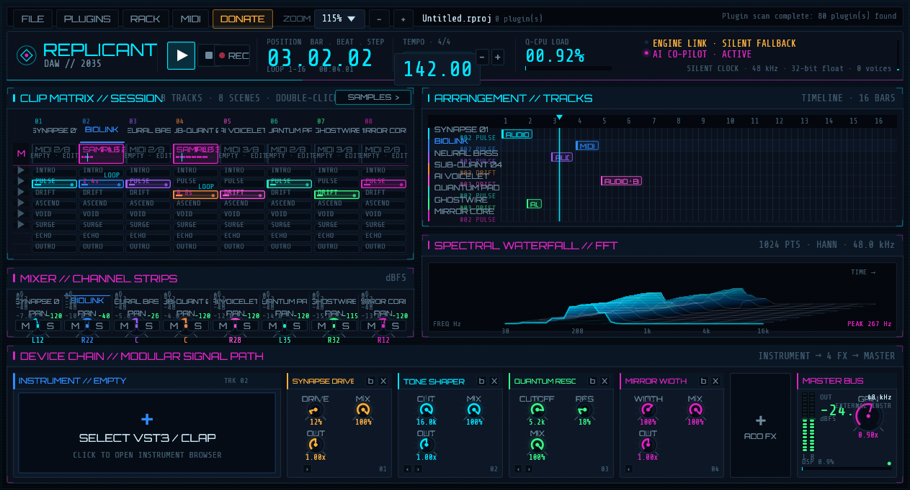
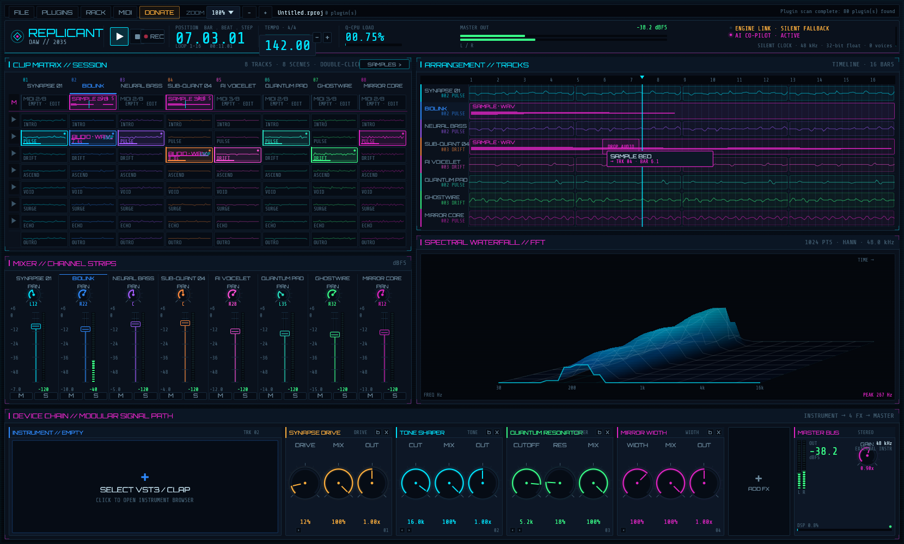
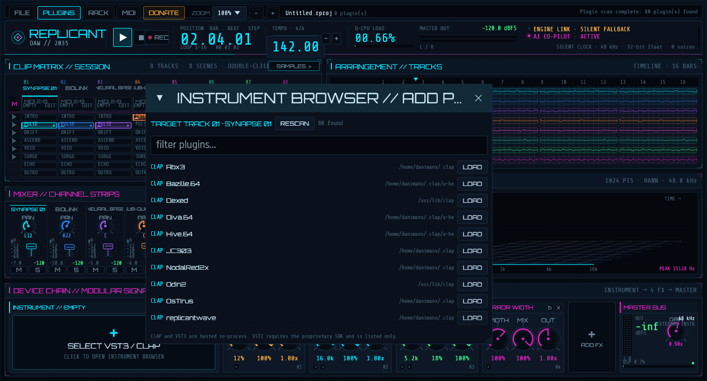
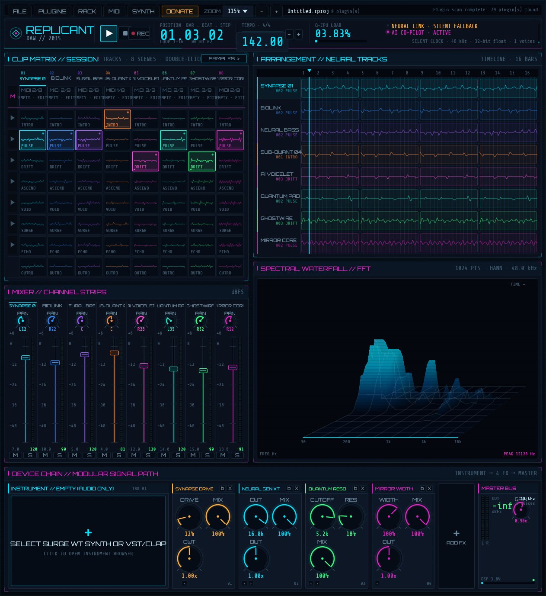
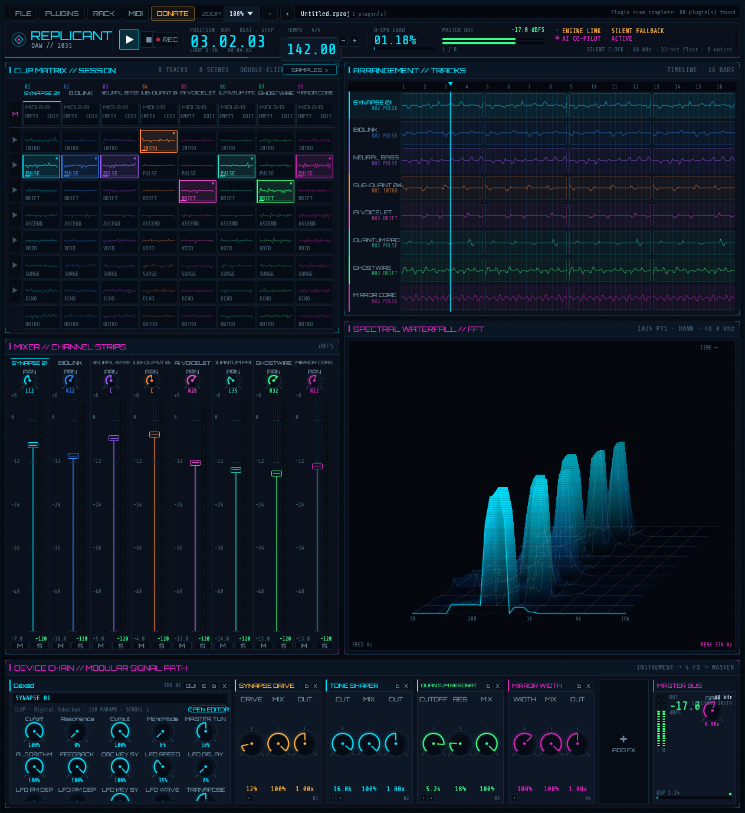

# Replicant DAW

A cyberpunk digital audio workstation in Rust: external CLAP/VST3 instruments,
an 8 × 8 session matrix, a 16-bar arrangement with independent audio and MIDI
clips, a modular master chain, MIDI recording and versioned `.rproj` projects.

Built with `eframe`/`egui` on `wgpu`; audio is rendered by `cpal` through
lock-free `rtrb` rings.

**Version 1.5.1** · MIT · Linux, macOS and Windows.


> Captured headlessly from the real binary with the silent fallback clock, so
> the status reads `SILENT FALLBACK`. A fresh session starts with an empty
> instrument slot and the plugins already scanned.

## What's new in 1.5.1

- **Host knobs now reach CLAP plugins that report a real parameter range.**
  CLAP automation carries the parameter's *plain* value, not the knob
  position. The rack sent the normalized `0.0..=1.0` position, so a plugin
  whose cutoff runs `0..20000` read the top of the knob as 1 Hz and a
  `-24..+24` semitone control as a rounding error. The knob moved, nothing
  sounded, and — with the plugin's own window open — the 400 ms refresh
  snapped it back. u-he instruments (Bazille, Diva, Hive, Zebra2, Repro) were
  the visible case; every CLAP whose range is not `0..1` was affected.
- **The conversion is measured, not guessed.** Each parameter's plain range is
  read once with its info and used to translate both directions: knob position
  to event value, and plugin value back to the knob.
- Verified with a real mouse under X11 against u-he Bazille: a panel knob
  dragged 57 % → 86 % keeps its value across the parameter refresh, and a
  regression test asserts that a wide-range CLAP parameter follows the host.
- Dexed (CLAP and VST3), Vital and JC303 keep behaving as before: their
  ranges are `0..1`, where the two scales coincide.

## Screenshots













## Features

- **One external instrument slot per track** — CLAP and VST3 are hosted
  in-process on a worker thread; VST2 is listed but not hostable.
- **Session matrix** — 8 tracks × 8 scenes, independent MIDI clips, audio
  samples, per-clip loops and mute.
- **Arrangement** — 16-bar timeline with audio and MIDI clips, a beat grid and
  an animated playhead. Drag clips in from the session matrix or audio files
  from the desktop. Each block owns its material and its loop region.
- **Audio clip editor** — waveform, trim, gain, normalize, reverse, fades,
  loop region and one-shot preview.
- **Piano roll** — add, move, resize and delete notes; per-clip loop region;
  velocity editing.
- **Mixer and master chain** — gain, pan, mute/solo, drive, tone, filter,
  width and delay modules, master gain and output protection.
- **Plugin hosting** — parameter surface, full-screen editor, native plugin
  windows, state save/restore, latency reporting.
- **Projects** — versioned JSON, quick save and a project browser.
- **Headless fallback** — the silent clock keeps meters, playhead and plugins
  running when no audio device is available.

## Requirements

- Rust 1.85 or newer.
- Linux: ALSA development headers and the usual windowing libraries.

  ```bash
  # Debian/Ubuntu
  sudo apt install build-essential pkg-config libasound2-dev \
      libxkbcommon-dev libwayland-dev libx11-dev libxi-dev

  # Fedora
  sudo dnf install alsa-lib-devel libxkbcommon-devel wayland-devel \
      libX11-devel libXi-devel
  ```

- macOS: Xcode command line tools.
- Windows: MSVC build tools; WASAPI is used through `cpal`.

Fonts and the app icon are embedded.

## Run

```bash
cargo run --release
```

```bash
cargo run --release -- --devices        # list audio output devices
cargo run --release -- --audio-check    # open the default device and verify telemetry
cargo run --release -- --selftest       # engine, chain, project, MIDI and clock smoke test
cargo run --release -- --project /path/to/project.rproj
cargo test
cargo clippy --all-targets -- -D warnings
```

Environment variables:

```bash
REPLICANT_DAW_NO_AUDIO=1          # force the silent fallback clock
REPLICANT_DAW_SIZE=1660x1000      # initial window size
REPLICANT_DAW_ZOOM=125            # UI scale at startup (75..200)
REPLICANT_DAW_PROJECT=x.rproj     # load a project at startup
REPLICANT_DAW_PROJECTS=dir        # override the projects directory
REPLICANT_DAW_PLUGIN_PATH=a:b     # extra plugin scan roots
REPLICANT_DAW_OPEN_PLUGIN=/path/to/plugin.vst3
WGPU_BACKEND=gl|vulkan|metal|dx12
```

Default project directory:

- Linux: `~/.local/share/replicant-daw/projects`
- macOS: `~/Library/Application Support/ReplicantDaw/projects`
- Windows: `%APPDATA%\ReplicantDaw\projects`

## Arrangement workflow

1. Open the instrument browser from `SELECT VST3 / CLAP` and load an instrument
   into a track. Without one, MIDI clips are silent.
2. Drop an audio file onto a lane, or drag any session cell — MIDI notes or a
   sample — onto a lane. The block lands on the nearest beat; a floating tag
   names the destination and a ghost block shows exactly where it will land.
3. The matrix keeps its clip: the timeline receives its own copy with the
   notes or the buffer it had when you pressed. Editing one never edits the
   other. Dragging a block back onto a session cell likewise copies it.
4. Drag a block along its lane or onto another one to move it. The grab point
   stays under the pointer, so a block does not jump on the first pixel.
5. Double-click an audio block to open the audio editor. Right-click for
   `OPEN AUDIO EDITOR` or `REMOVE FROM ARRANGEMENT`.
6. Press Space to play. Arrangement clips play at their absolute timeline
   position; the 16-bar loop wraps. Where a timeline clip covers a track, the
   session layer underneath it is silent.

## Controls

- **Space** — play / stop. **Esc** — stop and rewind.
- **Ctrl+S** — save. **Ctrl+O** — project window. **Ctrl+P** — plugin browser.
- **Ctrl + / Ctrl − / Ctrl 0** — zoom in / out / reset.
- **BPM** — click to type, drag vertically, or use `-` / `+`.
- **Clip slot** — click to launch, click again to stop; right-click for the
  clip menu.
- **Session cell** — drag to a lane or another cell; double-click to edit.
- **Arrangement lane** — drop audio files or dragged clips; drag a block to
  move it; double-click empty space to edit the track's source clip.
- **Fader / pan** — drag vertically, double-click to reset.
- **M / S** — mute and solo.
- **Effect module** — drag knobs; `b` bypasses, `X` closes, `‹ ›` reorders.
- **Rack** — load, bypass, edit or remove the plugin in each track.

## Plugin support

- **CLAP** — scan, load, stereo audio, note/parameter events, state, native
  editor.
- **VST3** — scan, load, audio, MIDI, parameters, state, latency, editor.
- **VST2** — discovered and listed only; the Steinberg SDK is not vendored.
- **Audio Unit** — not implemented.

Each track has one insert slot. Instruments generate the track's audio; effect
plugins process the track bus. Plugins run on a dedicated worker thread and
exchange 512-frame stereo blocks through lock-free rings.

Details, scan paths and known limits: [docs/PLUGINS.md](docs/PLUGINS.md).

## Project format

`.rproj` is versioned JSON. Format v10 stores tempo, mix, track names, session
MIDI clips, session samples, arrangement audio and MIDI clips, effect chain,
master gain and plugin state. Older formats load with migrations; a track whose instrument
id is `synth` loads as an empty slot because the built-in synth was removed.
Unknown fields are ignored and newer format versions are rejected with a clear
error.

## Limits

- One MIDI clip per session slot and one external instrument per track.
- One 16-bar loop; no automation lanes, undo or audio export.
- Plugin hosting is in-process: a crashing plugin can take the app down.
- Native plugin windows are tested on Linux/X11; other platforms fall back to
  the parameter editor.
- Windows and macOS are covered by CI builds but were not manually auditioned
  for this release.

## Support

Replicant DAW is free and open source. If it earns a place in your setup and
you feel like saying thanks, you can buy me a coffee — completely optional.

<p align="center">
  <a href="https://paypal.me/DanimanX?locale.x=en_US&amp;country.x=CL">
    
  </a>
</p>

<p align="center">
  <sub><a href="https://paypal.me/DanimanX?locale.x=en_US&amp;country.x=CL">paypal.me/DanimanX</a></sub>
</p>

---

## License

MIT. See [LICENSE](LICENSE).

The embedded fonts are licensed under the SIL Open Font License; license texts
are in [`assets/licenses/`](assets/licenses).
